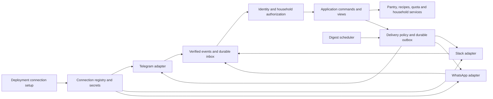

# Messaging providers and deployment-owned connections

**Status:** Implemented on dev on 2026-10-30. The [rollout record](../plans/2026-10-29-messaging-provider-abstraction.md) documents implementation decisions and the [connection guide](../../messaging-connections.md) describes the shipped behavior and remaining live acceptance checks. The sections below retain the original design rationale.
**Date:** 2026-10-29
**Scope confirmed by the owner:** The deployment owner configures shared provider
connections. Households use those connections without managing bot credentials.
**Implementation plan:** [Messaging provider rollout](../plans/2026-10-29-messaging-provider-abstraction.md).

## Decision

Keep Food Manager's pantry, recipes, household permissions, localization, and
quota services independent of the messaging platform. Introduce a typed
application boundary and adapters for Telegram, Slack, and WhatsApp Cloud API.
Several connections can run simultaneously. Replies use the originating
connection; reminders use the user's explicitly selected destination.

Deliver this in stages: extract Telegram first, prove the boundary with Slack,
then add WhatsApp and its notification policy. Provide an authenticated
deployment administration page for connection setup. Existing Telegram-only
deployments retain their environment-variable setup.

This remains one Python process, one HTTP server, one scheduler, and the existing
SQLite database. A separate microservice, generic plugin marketplace, Redis,
and a new web framework are unnecessary for the first release.

## What the repository already supports, and what must change

These observations describe the inspected checkout, not every statement in older
architecture documents.

| Current code | Implication |
| --- | --- |
| `app/ingest_service.py`, `pantry_service.py`, `cook/`, and `billing/` already expose service functions | Reuse domain behavior; extract orchestration from handlers rather than copy services per provider. |
| `app/renderer.py::CallbackButton`, `app/views.py`, `app/telegram_ui.py` | A useful rendering seam exists, but callback strings and keyboard layouts still reflect Telegram. |
| `app/handler_support.py`, `app/handlers/`, `app/callbacks/`, `app/progress.py` | They depend on Telegram-shaped messages, callbacks, identities, or replies even where imports are absent. |
| `app/models.py::User` | `telegram_id` is the primary key; `chat_id` is required. A transport wrapper alone cannot admit a Slack-only user. |
| `GroupBinding`, `PendingCorrection`, `CookSession`, `MealPlan`, `PantryBatch`, invites and outcomes | Conversation addresses, ownership, and historical actor references also need an explicit migration. |
| `Receipt.photo_file_id` and `ingest_photo()` | Deduplication assumes a provider file identifier; unrelated providers can have colliding identifiers. |
| `app/scheduler.py` | Directly sends through a bot, builds an aiogram keyboard, and keys jobs by Telegram user ID. |
| `app/webapp_auth.py`, `app/webapp.py`, `app/miniapp_workspace.py` | The web UI authenticates through Telegram and passes Telegram IDs to application work. |
| `app/billing/`, `app/handlers/billing.py`, `app/operator/` | Quota is reusable; Stars receipts, payer IDs, refunds, and operator authentication have distinct Telegram contracts. |
| `bin/run.py`, `app/settings.py` | Startup requires Telegram credentials and unconditionally constructs a bot. It already runs an aiohttp server on `PORT`. |

## Boundaries



Proposed modules:

```text
app/messaging/contracts.py           # Typed events, addresses, content, results
app/messaging/identity_service.py    # External identities and explicit linking
app/messaging/connection_service.py  # Configuration, lifecycle, secret references
app/messaging/inbox_service.py       # Durable admission, deduplication, work leases
app/messaging/delivery_service.py    # Policy, outbox, retries, delivery receipts
app/messaging/action_service.py      # Persisted, scoped interactive action tokens
app/messaging/adapters/telegram/     # aiogram, Telegram verification and rendering
app/messaging/adapters/slack/        # Slack verification, events, Block Kit
app/messaging/adapters/whatsapp/     # Cloud API verification, media and templates
app/application/commands/            # Shared orchestration extracted by workflow
app/connection_admin.py              # Deployment-owner HTTP setup API
```

`MessagingProvider` is separate from the existing LLM `Provider`. Messaging
adapters are selected by connection ID, never through LLM fallback selection.
A failed send must not silently move a private response to another platform.

The application receives validated values and uses existing session injection
and explicit `today`/`now` inputs. It never receives an aiogram message, Slack
client, WhatsApp payload, HTTP request, or provider exception. Avoid implementing
a fake Telegram message object for Slack: that preserves the existing coupling.

## Core contract

The following Python contract is the proposed shared interface, not shipped code.
External IDs remain opaque strings, including Slack timestamps and numeric-looking
WhatsApp/Telegram IDs. Internal IDs are distinct types.

```python
from dataclasses import dataclass
from datetime import datetime
from typing import Literal, NewType, Protocol

ConnectionId = NewType("ConnectionId", str)
UserId = NewType("UserId", str)
ActionToken = NewType("ActionToken", str)
MessagingProvider = Literal["telegram", "slack", "whatsapp"]

@dataclass(frozen=True)
class ActorRef:
    connection_id: ConnectionId
    external_user_id: str

@dataclass(frozen=True)
class ConversationRef:
    connection_id: ConnectionId
    external_conversation_id: str
    kind: Literal["direct", "shared"]
    thread_id: str | None = None

@dataclass(frozen=True)
class MessageRef:
    conversation: ConversationRef
    external_message_id: str

@dataclass(frozen=True)
class MediaRef:
    connection_id: ConnectionId
    external_media_id: str

@dataclass(frozen=True)
class TextReceived:
    text: str

@dataclass(frozen=True)
class ImageReceived:
    media: MediaRef
    caption: str | None = None

@dataclass(frozen=True)
class ActionInvoked:
    token: ActionToken
    source: MessageRef

@dataclass(frozen=True)
class IncomingEvent:
    event_key: str
    actor: ActorRef
    conversation: ConversationRef
    received_at: datetime
    content: TextReceived | ImageReceived | ActionInvoked
    reply_to: MessageRef | None = None

@dataclass(frozen=True)
class ActionButton:
    label: str
    token: ActionToken

@dataclass(frozen=True)
class LinkButton:
    label: str
    url: str

@dataclass(frozen=True)
class ChatMessage:
    text: str
    buttons: tuple[ActionButton | LinkButton, ...] = ()

@dataclass(frozen=True)
class DigestNotice:
    localized_message: ChatMessage
    due_count: int
    language: str

@dataclass(frozen=True)
class DeliveryRequest:
    delivery_key: str
    conversation: ConversationRef
    content: ChatMessage | DigestNotice
    replace: MessageRef | None = None

@dataclass(frozen=True)
class Accepted:
    messages: tuple[MessageRef, ...]

@dataclass(frozen=True)
class Suppressed:
    reason: Literal["opted_out", "template_required", "destination_unavailable"]

@dataclass(frozen=True)
class DownloadedImage:
    data: bytes
    mime_type: Literal["image/jpeg", "image/png", "image/webp"]

class MessagingAdapter(Protocol):
    async def deliver(self, request: DeliveryRequest) -> Accepted | Suppressed: ...
    async def download_image(self, media: MediaRef) -> DownloadedImage: ...
```

Contract semantics:

- Adapters authenticate and normalize ingress; the runtime owns HTTP routes,
  polling/socket lifecycle, and shutdown. No generic `ack()` is exposed to domain
  handlers. Acknowledgement deadlines are provider ingress responsibilities.
- Every reference in an event or delivery must belong to the same connection and
  authorized conversation. Validate this at ingress and delivery admission.
  A message replacement must target that same conversation and thread.
- `event_key` is stable for a provider retry and unique within its connection.
  Telegram uses update ID; Slack Events uses event ID; WhatsApp uses the individual
  message ID, not the whole webhook batch. Slack interactions/commands use their
  documented delivery identifiers or a canonical verified-payload fingerprint.
- Explicit commands are normalized before dispatch: Telegram `/pantry`, Slack
  `/food pantry`, and WhatsApp `pantry` reach the same command. Preserve all current
  Telegram aliases; unknown text continues through the existing intent workflow.
- `ChatMessage.text` is plain localized content. Adapters own escaping, splitting,
  layout and provider limits. Preserve current Telegram English output through
  renderer compatibility tests. Keep translation asynchronous outside renderers.
- Actions use a persistent opaque token whose record contains the typed command,
  resource/version, household, conversation, expiry, and audience. Audience is
  explicitly either one user or current members of one household. Every invocation
  rechecks current membership, bans, resource ownership and expected version.
  Persist before sending; tokens survive restarts. Expired actions offer a fresh
  view. Legacy Telegram callback formats retain their existing validated decoder.
- `replace` is a preference. Unsupported edits or an unavailable old message can
  produce a new message; identical-content edits succeed. Authentication failures,
  rate limits and unknown outcomes must not become unconditional resend loops.
- `Accepted` means the provider accepted the send, not that the person received
  or read it. Multiple references cover messages split to fit provider limits.
- Expected policy blocks return `Suppressed`. All actual adapter failures raise
  one `MessagingError` family with `code`, safe `message`, optional
  `retry_after_seconds`, and a correlation ID. Codes: `INVALID_INPUT`,
  `AUTH_FAILED`, `FORBIDDEN`, `NOT_FOUND`, `RATE_LIMITED`, `TEMPORARY_FAILURE`,
  `DELIVERY_UNKNOWN`, `UNSUPPORTED`. Retry decisions follow the code, not raw text.
- Media is retrieved only through provider-owned references and credentials.
  Validate size, decoded image type, timeout and provider response schemas before
  LLM work. Arbitrary inbound URLs are not a download instruction. Follow only
  validated provider media locations; never forward credentials across hosts.

Expose adapter capabilities to the presenter (`images`, `interactive_actions`,
`message_editing`, `shared_conversations`, `threads`) with explicit size/action
limits. Those describe this implementation, not every feature the vendor offers.
Daily notification eligibility is evaluated per destination and time; it cannot
be represented by a static `supports_notifications` boolean.

## Identity, persistence and authorization

Use one internal user identity with one current household, as today. Multiple
external identities can point to that user. A connection is deployment-wide,
not a household, and installing a Slack app never grants access to a household.

| Model/change | Contract and constraints |
| --- | --- |
| `User.id` | New opaque internal ID, eventually the primary key. Retain language, timezone, digest hour, LLM preference and ban state here. Legacy Telegram fields become nullable compatibility fields. |
| `ExternalIdentity` | Unique `(connection_id, external_user_id)` maps to `User.id`. Connection identifies the verified Telegram bot, Slack workspace/app installation, or WhatsApp sender account. A token rotation preserves connection ID; replacing the actual bot/workspace/number creates a new connection. |
| `MessagingConnection` | Stable ID, provider, verified external account scope, label, ingress mode, secret reference, desired enabled state, observed health, revision. Prevent duplicate active connections to the same external installation. |
| `ConversationBinding` | Unique connection/conversation address maps a shared conversation to one household. Retain thread context in messages; do not implicitly create separate household bindings per thread. |
| `NotificationDestination` | User, verified direct conversation, opt-in/opt-out, last customer-message time where relevant. One active daily digest destination per user initially. Linking another platform does not enable duplicate reminders. |
| `InboxEvent` / `OutboxDelivery` | Unique `(connection_id, event_key)` / `delivery_key`, state, attempt count, work lease, next attempt, safe error code. Outbox also stores authorized user/household, membership generation and provider receipts. |
| Interactive records | Add neutral conversation/message references to corrections, cooks and plans; migrate batch ownership to internal user ID. Retain legacy columns while old readers exist. |
| Receipt source | Add a connection-scoped media/source identity. Backfill existing receipts into the legacy Telegram connection; preserve existing duplicate behavior. A content hash can flag likely duplicates across providers but must not silently discard a deliberate second purchase. |

Replace the legacy `(household_id, photo_file_id)` uniqueness constraint with
the canonical scoped source key when new-provider receipt writes are enabled.
Keeping the old constraint on raw provider IDs would still create cross-provider
collisions. The Telegram compatibility resolver must query the same backfilled
source key; old callers must not create a second receipt namespace.

External account scope must come from verified credentials and inbound provider
metadata, never just a user-supplied URL path or workspace field. Reject mismatched
app/team/phone identifiers before identity lookup. Ingress ignores own-bot echoes,
unsupported system events, and delivery statuses as application commands.

Preserve the existing registration and local/hosted mode policies. Local mode
admits the explicitly configured bootstrap identity and identities linked by that
person. Slack/WhatsApp-only deployments configure a provider-scoped bootstrap
identity instead of requiring `ALLOWED_TELEGRAM_USER_ID`. Never assign ownership
to the first stranger who messages a newly connected bot. Hosted mode still
checks registration policy, bans, invitations and seat limits centrally.

Cross-provider account linking is a separate action from joining a household.
Use a short-lived, single-use, hashed token issued in an authenticated private
conversation, redeemed through a verified destination identity, and confirmed by
the original user. Rate-limit attempts. Names, email addresses and phone-number
similarity are not proof of account ownership. Linking two existing users with
different household state returns a conflict; automatic account merging is deferred.

Leaving/removal must revoke household membership across all linked identities,
cancel jobs and pending deliveries, revoke invites, and transfer shared bindings
as today. Preserve the internal identity and ban state with no active household;
do not delete just one provider identity. Rejoining/provisioning then requires an
explicit authorized action. Preserve historical outcome/payment provenance;
never reinterpret an old Telegram actor number as a newly created internal user.

## Ingress, retries and daily digests

1. Verify signature/secret, timestamp where supported, body size and schema.
   WhatsApp's GET verification challenge and signed POST delivery are separate
   checks. For Slack, verify the raw body before parsing it.
2. Insert a bounded normalized event into the durable inbox and commit. Acknowledge
   accepted or duplicate deliveries immediately, before translation or LLM calls.
   If persistence fails, do not acknowledge successful admission. Slack requires
   responses within three seconds; keep this path short and fail for retry under
   overload. Polling offsets must advance only after durable admission.
3. A worker leases the event, resolves current identity/household permissions, and
   runs the command. Persist operation completion and outbox intent atomically
   with domain mutations. Existing service-level commits need deliberate
   transaction-boundary changes for this guarantee; an outer wrapper is insufficient.
4. Dispatch the outbox after checking current membership, ban state, connection
   state and destination policy again. Apply bounded backoff for retryable errors.
   Process delivery receipts separately from incoming user messages.

Do network/LLM work outside short SQLite write transactions. Before committing
its results, recheck membership generation, bans and resource versions so a
removed user or stale action cannot mutate a household after slow work finishes.
This also keeps inbox admission from waiting behind an LLM-held database lock.

This gives retry-safe domain effects, not universal exactly-once message delivery.
A crash after a provider accepts a send but before the receipt is saved can leave
an unknown outcome. Reconcile where possible; otherwise record `DELIVERY_UNKNOWN`
and do not automatically duplicate a purchase, paid LLM operation, or message.
Persist LLM stage results/attempts so an incomplete stage is not falsely reported
as free or blindly rerun after a crash.

Serialize conflicting mutations by household in the single-process worker and
retain database version/uniqueness guards. Leases recover interrupted work after
restart. Invalid/poison events have bounded attempts and a visible failed state.
Use retention limits for inbox bodies and media; keep minimal deduplication keys
for the supported provider replay horizon. Do not persist credentials in payloads.

Schedule with internal user ID. A logical digest has a unique `(user_id, local_date)`
run, including silent days. Delivery attempts belong to that run, so changing the
destination does not create a second daily digest. Track prepared, accepted,
suppressed, failed and unknown separately; retain compatibility for
`last_digest_date` until consumers are migrated. Catch-up and a live cron firing
must converge on the same run.

For WhatsApp, check the last customer-message time and consent at send time.
Outside the customer-service window, use a configured approved template for the
recipient's locale; if unavailable, suppress with `template_required` and show
the reason to the deployment owner. A template can invite the user to reply for
the full pantry list. Do not send a free-form digest to bypass the restriction.
Opting out prevents queued reminders too.

## Deployment-owner setup

Add `/admin/connections`, served by the existing HTTP process with its own
deployment-admin authentication. Household ownership and a valid Telegram Mini
App session grant no access to connection secrets or deployment administration.

The first release uses a deployment secret `CONNECTION_ADMIN_TOKEN`, generated
and stored by the owner through their host's secret settings. Exchange it through
a login form for a short-lived server-side session, using Secure, HttpOnly,
SameSite=Lax cookies, CSRF protection, rate limiting and reauthentication for
credential replacement. Never put the token in a link or localStorage. This
works on a fresh Slack-only or WhatsApp-only deployment without Telegram login.

The setup flow is: **choose provider → supply credentials or install → verify
account → configure inbound delivery → receive a test → choose bootstrap
identity → enable**. Display generated URLs, precise missing steps, connection
health and disabled capabilities. An outbound test is an explicit owner action
to a verified destination. API token validation alone is not a successful test.

| Provider | Owner setup and first-release support |
| --- | --- |
| Telegram | Paste BotFather token, verify bot identity, choose owner Telegram ID; retain polling as default. Webhook mode is optional and mutually exclusive with polling. |
| Slack | Provide a ready-to-import app manifest with the deployed URLs and least-required scopes. Owner creates the Slack app, configures its client ID/secret and signing secret, then selects **Connect Slack** for OAuth installation. First release supports one workspace per connection, direct messages, image receipt and actions. Add household-bound channels after direct-message parity. |
| WhatsApp Cloud API | Guide the owner through Meta business/app and sender-phone setup, then enter the access token, app secret, verification token, business account ID and phone number ID. Show the callback URL and subscription checks. Direct conversations first. Configure digest template names/locales and confirm consent. |

Slack HTTP ingress is the first deployed path because this app already exposes
HTTP and WhatsApp needs it. Socket Mode is a later alternative for deployments
that cannot expose public ingress. A bot token plus incoming webhook URL is not
a complete Slack command/action integration.

WhatsApp setup cannot honestly be reduced to pasting a personal WhatsApp number.
Meta account eligibility, sender onboarding and template approval happen outside
Food Manager. Embedded Signup can be a future improvement after the deployment's
Meta app prerequisites are established; it is not a prerequisite for this rollout.
No unofficial WhatsApp Web session automation is included.

Proposed configuration, **not yet supported environment variables**:

```dotenv
# Required for externally delivered webhooks and the deployment setup UI.
PUBLIC_BASE_URL=https://food.example.com
CONNECTION_ADMIN_TOKEN=<deployment-secret>
CONNECTION_SECRET_KEY=<independent-persistent-encryption-key>

# Optional environment-managed connection import, one of each provider initially.
MESSAGING_PROVIDERS=telegram,slack,whatsapp
TELEGRAM_BOT_TOKEN=<existing-name-preserved>
ALLOWED_TELEGRAM_USER_ID=<existing-name-preserved>
SLACK_CLIENT_ID=<app-id>
SLACK_CLIENT_SECRET=<secret>
SLACK_SIGNING_SECRET=<secret>
WHATSAPP_ACCESS_TOKEN=<secret>
WHATSAPP_APP_SECRET=<secret>
WHATSAPP_VERIFY_TOKEN=<secret>
WHATSAPP_BUSINESS_ACCOUNT_ID=<id>
WHATSAPP_PHONE_NUMBER_ID=<id>
```

The wizard and environment import populate the same connection registry.
Environment-owned credentials are visibly read-only in the wizard; changing their
source is explicit. Absence of `MESSAGING_PROVIDERS` plus the existing Telegram
token imports the legacy Telegram connection once. Enabling another provider
does not require Telegram secrets. Wizard-created connections persist independently
of the environment import list. Zero enabled connections is a valid setup-only
state with no bot polling or digest sending.

Store credentials encrypted at rest using a maintained authenticated-encryption
library; keep the encryption key outside SQLite in deployment secrets. Public
connection responses expose only credential presence. Backups need a documented
key-recovery procedure. Rotation validates the same external account, changes the
secret reference atomically and restarts only that adapter. Never log secret
values, provider response URLs, OAuth codes, or raw authorization headers.

Preserve `/healthz` as process liveness. Add `/readyz` for database/worker readiness
and private per-connection diagnostics. A revoked Slack token can mark Slack
degraded while Telegram keeps working. Connection states distinguish unconfigured,
awaiting installation, awaiting inbound verification, ready, degraded and disabled.
Do not restart every healthy adapter because one provider is unavailable.

## Setup HTTP contract

All routes below are proposals. Use JSON input/output schemas, camelCase wire
fields, opaque IDs, and uppercase error codes consistently.

| Route | Typed request | Typed response |
| --- | --- | --- |
| `POST /admin/api/sessions` | `{token: string}` | `{expiresAt: datetime}` plus session cookie |
| `DELETE /admin/api/sessions/current` | none | 204; invalidates session |
| `GET /admin/api/connections?cursor=...&limit=20` | optional cursor, limit 1–100 | `{data: ConnectionView[], nextCursor: string \| null}` |
| `POST /admin/api/connections` | `ConnectionCreate` | 201 `ConnectionView` |
| `GET /admin/api/connections/{id}` | none | `ConnectionView` |
| `PATCH /admin/api/connections/{id}` | `ConnectionPatch`, `If-Match` revision | updated `ConnectionView` |
| `POST /admin/api/connections/{id}/checks` | none | `{checks: CheckResult[], checkedAt: datetime}` |
| `POST /admin/api/connections/{id}/test-messages` | `{destinationId: string}` | 202 `{deliveryId: string, status: "QUEUED"}` |
| `POST /admin/api/connections/{id}/installations` | none; Slack only | `{authorizationUrl: string, expiresAt: datetime}` |

`ConnectionCreate` is a discriminated union:

- Telegram: `provider: "telegram"`, `label: string`,
  `settings: {mode: "polling" | "webhook", bootstrapUserId: string}`,
  `credentials: {botToken: string, webhookSecret?: string}`.
- Slack: `provider: "slack"`, `label: string`,
  `settings: {mode: "http", bootstrapUserId: string}`,
  `credentials: {clientId: string, clientSecret: string, signingSecret: string}`.
  Workspace scope and bot token come from verified OAuth results.
- WhatsApp: `provider: "whatsapp"`, `label: string`,
  `settings: {businessAccountId: string, phoneNumberId: string,
  bootstrapUserId: string, digestTemplates: {language: string, name: string}[]}`,
  `credentials: {accessToken: string, appSecret: string, verifyToken: string}`.

`ConnectionPatch` permits optional `label`, `enabled`, and provider-specific
`settings`/`credentials` patches. Omitted fields stay unchanged; null cannot clear
a required credential. Provider and verified external account scope are immutable.
Enabling requires successful credential and inbound checks. Replacing a secret
requires all fields needed to validate that credential set. Responses never echo
the credential object. An installation is not enabled until bootstrap identity
and inbound delivery are verified.

`ConnectionView` fields: `id: string`, `provider: MessagingProvider`,
`label: string`, `enabled: bool`, `state: string` (the lifecycle above),
`externalAccount: string | null`, `revision: int`, `credentialsPresent: bool`,
`credentialSource: "environment" | "managed"`, `lastCheckedAt: datetime | null`,
`capabilities: string[]`, `lastErrorCode: string | null`. Each `CheckResult` has
`code: string`, `status: "PASS" | "FAIL" | "PENDING"`, and safe `message: string`.
Checks are bounded, read-only probes; they do not send messages or silently
replace webhooks. Setup provides explicit owner actions for external registration.

All JSON errors use `{error: {code: string, message: string,
details?: {field: string, reason: string}[], requestId: string}}`.
Use 400 malformed input, 401 unauthenticated, 403 wrong role, 404 unavailable
resource, 409 stale revision/account conflict, 422 configuration validation,
429 rate limit, and 503 temporary upstream failure. Never return raw SDK errors.
Creation and test-message POSTs accept an idempotency key scoped to the admin
session owner; reusing a key with different input returns 409.

Public provider routes are separate from this admin API:

- `POST /webhooks/telegram/{connectionId}` verifies its webhook secret.
- `POST /webhooks/slack/{connectionId}` verifies signed events/commands/actions;
  content type selects decoding, not the application command's authority.
- `GET|POST /webhooks/whatsapp/{connectionId}` handles challenge and signed events.
- `GET /admin/oauth/slack/callback` verifies single-use expiring state bound to
  the initiating admin session, connection and redirect URI, exchanges the code
  server-side, and redirects to the connection page without credentials.

Provider acknowledgement/challenge bodies follow the provider contract, not the
JSON admin error shape. Register these routes before the existing web SPA fallback.

## Compatibility and rollout acceptance

Preserve Telegram commands, callback formats, default English output, existing
environment variables, household data, quota admission/accounting and Stars
ledger fields. Telegram invoice, pre-checkout and payment events stay in the
Telegram payment integration; do not flatten them into ordinary chat actions.
Slack/WhatsApp expose quota and entitlement status but have no purchase flow in
this release. Refunds and subscription cancellation continue using the original
Telegram payer/charge IDs.

Telegram Mini App auth remains valid and resolves its verified Telegram identity
to the internal user. It is not a cross-provider login mechanism. The new
deployment setup page has independent auth; general Slack/WhatsApp web-app login
is deferred. The operator bot can remain Telegram-specific while its domain
queries use internal users; missing optional operator credentials must not prevent
a Slack-only deployment from starting. Deployment administration does not inherit
operator-bot or household-member authority automatically.

Acceptance requires:

1. Existing Telegram tests and database fixtures pass after migration, including
   old interactive cards, household removal, billing and Mini App behavior.
2. Slack-only and WhatsApp-only configurations start without a Telegram token.
   All household authorization/quota behavior is shared with Telegram.
3. Replayed events and restarted workers do not repeat domain mutations; tests
   cover send/receipt crash gaps and unknown outcomes explicitly.
4. Linked users receive one daily digest at their chosen destination; unlinked
   users and similarly named Slack accounts cannot access each other's household.
5. An owner can configure, test, disable and rotate a connection from the deployed
   setup page; household users cannot manage it or read its credentials.
6. Local contract tests and live provider acceptance are reported separately.
   The release is not declared complete solely because fake adapters pass.

## Provider evidence and verification limits

Documentation was queried through Context7 for Telegram Bot API
(`/websites/core_telegram_bots_api`), Slack Platform (`/websites/slack_dev`) and
Meta's official Cloud API examples (`/fbsamples/whatsapp-api-examples`).

- [Telegram Bot API](https://core.telegram.org/bots/api): polling/webhook delivery,
  update identifiers, callback acknowledgements and Stars-specific payments.
- [Slack OAuth installation](https://docs.slack.dev/authentication/installing-with-oauth/):
  owner installation obtains scoped tokens; app registration still precedes it.
- [Slack request verification](https://docs.slack.dev/authentication/verifying-requests-from-slack/)
  and [acknowledgements](https://docs.slack.dev/tools/bolt-python/concepts/acknowledge/):
  verify requests and acknowledge promptly before long-running work.
- [Slack Socket Mode](https://docs.slack.dev/apis/events-api/using-socket-mode/):
  optional alternative without a public event request URL.
- [Meta webhook example](https://github.com/fbsamples/whatsapp-api-examples/blob/main/template-for-ecommerce-js/routes/incomingWebhook.js)
  and [template send example](https://github.com/fbsamples/whatsapp-api-examples/blob/main/send-messages-flight-app-python/message_helper.py):
  webhook challenge/signature, interactive replies and template sending.

Direct Meta documentation returned HTTP 429 during this review. Context7's
official examples support the integration shape, but current account eligibility,
consent requirements, template categories, limits and selected Graph API version
must be verified during implementation and live onboarding. No connected provider
account, deployed webhook, payment or production migration was exercised here.
